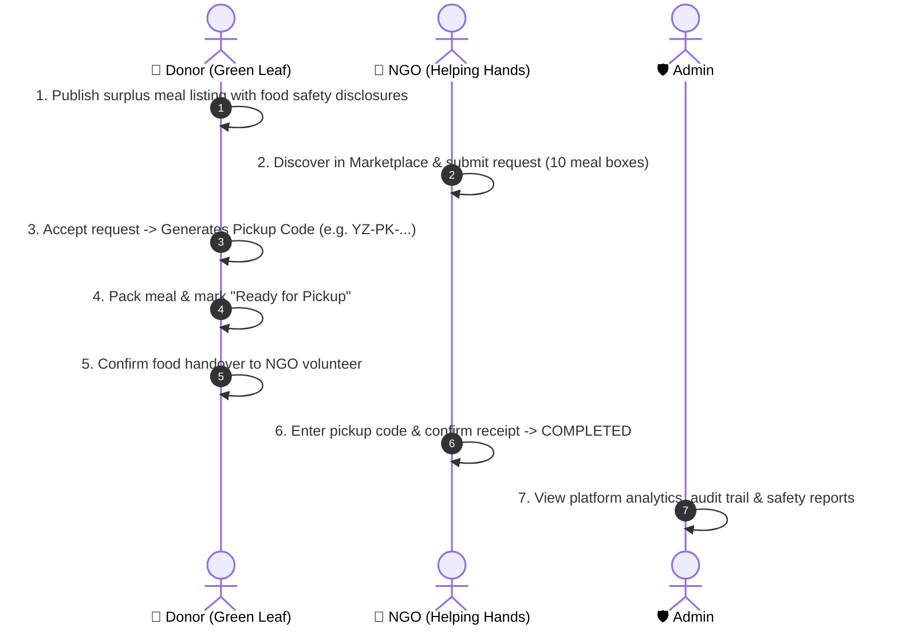

# 🍽️ YUMZY — HACK-P197 Hackathon Demo Guide (3–5 Minutes)

> **Tagline:** *Share More. Waste Less. Feed Everyone.*  
> **Problem ID:** HACK-P197 | Premium Food Donation & Redistribution Marketplace  
> **Live App URL:** [http://localhost:5173](http://localhost:5173)  
> **Backend API:** [http://localhost:5000/api](http://localhost:5000/api)  

---

## ⚡ Instant Demo Credentials
Every account uses the uniform demo password:  
🔑 **Password:** `YumzyDemo@123`

| Role | Email | Organization Name | Key Capabilities |
| :--- | :--- | :--- | :--- |
| **🏢 Food Donor** | `donor@yumzy.demo` | **Green Leaf Restaurant** (Banjara Hills) | Publish surplus food, review incoming requests, atomic inventory reservation, issue pickup code, confirm handover |
| **🤝 Recipient NGO** | `ngo@yumzy.demo` | **Helping Hands Foundation** (Banjara Hills) | Marketplace discovery, rule-based compatibility scoring, atomic request reservation, pickup code verification |
| **🛡️ Platform Admin** | `admin@yumzy.demo` | **Yumzy Platform Moderator** | User suspension/activation, food safety report review, listing moderation, impact analytics |

> 💡 **Hackathon Tip:** The top navigation bar includes an instant **"⚡ Quick Demo"** button on every page. Clicking it will switch accounts in 1 click without needing to type!

---

## ⏱️ Step-by-Step 3–5 Minute Demonstration Sequence

---

### Phase 1: Public Experience & Telugu Bilingual Support (30 Seconds)
1. Open [http://localhost:5173](http://localhost:5173).
2. Note the Zomato-inspired food marketplace UI, hero tagline, platform statistics counter, and the **HACK-P197 Mandatory Food Safety Responsibility Banner**.
3. Click the **"తెలుగు"** language toggle in the navbar.
   - Observe real-time translation of navigation, hero text, and button labels into fluent Telugu Unicode.
   - Click **"English"** to switch back seamlessly.

---

### Phase 2: Donor Experience (Green Leaf Restaurant) (60 Seconds)
1. In the navbar, click **"⚡ Quick Demo"** ➔ Select **"🏢 Green Leaf Restaurant (Donor)"** (or log in with `donor@yumzy.demo` / `YumzyDemo@123`).
2. You land on the **Donor Overview Dashboard** (`/donor/overview`):
   - Review live metrics: *Total Listings*, *Pending Requests*, *Completed Pickups*, and *Meals Donated*.
3. Click **"Publish New Food"** (`/donor/add-donation`):
   - **Food Item Name:** `Fresh Paneer Biryani Meal Trays`
   - **Category:** `Vegetarian`
   - **Quantity:** `30` (Meals)
   - Notice the **Preset Photo Selector**: click the Biryani photo.
   - Point out **Section 23 Food Safety Disclosures**:
     - *Preparation timestamp*
     - *Storage temperature guidance*
     - *Allergen warnings (Dairy, Cashews)*
     - *Pickup deadline*
4. Click **"Publish Surplus Food Listing"**.
5. You are redirected to **"My Donations"** (`/donor/my-donations`) where the new listing is live with status `AVAILABLE`.

---

### Phase 3: Recipient NGO Discovery & Atomic Request (60 Seconds)
1. In the navbar, click **"⚡ Quick Demo"** ➔ Select **"🤝 Helping Hands Foundation (NGO)"** (or log in with `ngo@yumzy.demo` / `YumzyDemo@123`).
2. Navigate to **"Explore Food"** (`/explore`):
   - Notice the **Smart Rule-Based Matching Engine Banner** showing donations ranked by compatibility score (distance, dietary type, capacity).
   - Test category filters: click **"Vegetarian"** or search `"Biryani"`.
   - Click the **"Map View"** button to show interactive Leaflet OpenStreetMap pickup pins across Hyderabad localities.
3. On the `Fresh Paneer Biryani Meal Trays` card:
   - Click **"View Details"** to show the mandatory Food Safety Disclosures modal.
   - Click **"Request Food"**:
     - **Required Quantity:** `10`
     - **Expected Pickup Time:** Select an upcoming time before the deadline.
     - **Coordination Note:** `Our volunteer van will arrive with thermal carriers.`
   - Click **"Submit Food Request"**.
4. Navigate to **"My Requests"** (`/ngo/my-requests`):
   - View the pending request for 10 meals.

---

### Phase 4: Donor Approval & Pickup Code Issuance (45 Seconds)
1. Switch back to **Green Leaf Restaurant** (`donor@yumzy.demo`).
2. Navigate to **"Incoming Requests"** (`/donor/incoming-requests`):
   - Review the incoming request from *Helping Hands Foundation* for 10 meals.
3. Click **"Accept & Reserve Food"**:
   - Backend atomically locks 10 meals from `availableQuantity` and moves them to `reservedQuantity`.
   - A unique pickup code is generated: e.g. `YZ-PK-XXXXX`.
4. Navigate to **"Pickup Coordination"** (`/donor/pickup-management`):
   - The visual 4-step timeline shows `Accepted`.
   - Click **"Mark Ready for Pickup"** (status becomes `READY_FOR_PICKUP`).
   - Click **"Confirm Food Handover"** (Donor step 1 of dual confirmation checked).

---

### Phase 5: NGO Pickup Collection & Dual Confirmation (45 Seconds)
1. Switch back to **Helping Hands Foundation** (`ngo@yumzy.demo`).
2. Navigate to **"Pickup Tracking"** (`/ngo/pickup-tracking`):
   - Notice the real-time status update: `Ready for Pickup`.
   - The unique pickup code is displayed.
   - Notice the **Dual Confirmation Status Box**:
     - Donor Handover: ✅ Confirmed
     - NGO Receipt: ⏳ Awaiting confirmation
3. In the verification input, enter the pickup code and click **"Confirm Food Collection"**.
4. Both parties have verified physical handover!
   - Status updates to `COMPLETED`.
   - Notification is sent to both parties.
   - Impact metrics are permanently recorded in the database.

---

### Phase 6: Admin Dashboard, Impact Analytics & Moderation (60 Seconds)
1. In the navbar, click **"⚡ Quick Demo"** ➔ Select **"🛡️ Platform Admin"** (`admin@yumzy.demo`).
2. You land on the **Platform Master Administration Panel** (`/admin/overview`):
   - **Platform Metrics:** 9 Users, 12+ Listings, 0 Pending Reports, 45+ Meals Redistributed.
   - **Interactive Recharts Visualizations:**
     - *Monthly Food Redistribution Trends* (Bar chart)
     - *Surplus Categories Distribution* (Pie chart)
   - **Safety & Content Reports Center:**
     - Review reported items submitted by users (e.g. food safety inquiries).
     - Single-click action to dismiss or close reported listings.
   - **User Management:**
     - Instant account toggle: *Active* ⇄ *Suspended*.
   - **Audit Activity Logs:**
     - Immutable audit trail recording user registrations, request submissions, state transitions, and admin actions.

---

## 🎯 Key Hackathon Strengths to Highlight to Judges
1. **Not a Mockup:** Real MongoDB persistence, Express REST APIs, atomic inventory decrement (`$inc: { availableQuantity: -qty }`), and zero mock frontend state.
2. **HACK-P197 Food Safety Compliance:** Mandatory preparation time, allergen warnings, storage guidelines, pickup deadlines, and clear disclaimer banner on every page.
3. **Dual Confirmation Security:** Neither party can falsely claim food was handed over or received without mutual digital confirmation.
4. **Rule-Based Smart Matching:** Transparent 100-point compatibility scoring based on proximity, food category, and daily NGO capacity without fake AI claims.
5. **Telugu Regional Localization:** Native bilingual experience tailored for Telangana state stakeholders.

