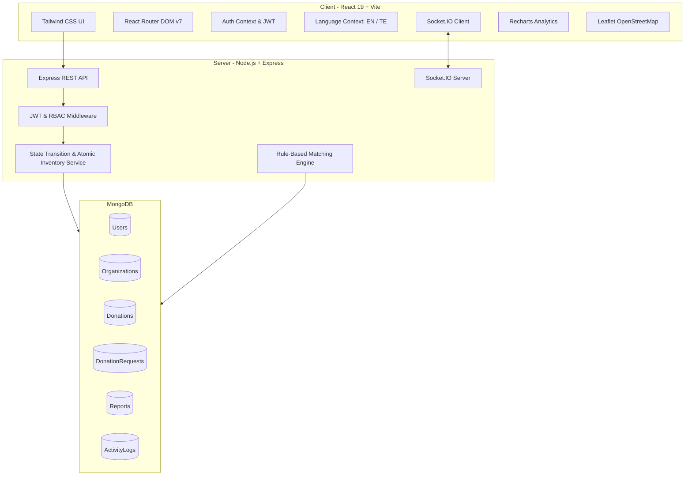

# 🍽️ YUMZY — Premium Food Donation & Redistribution Marketplace

[](https://github.com)
[](https://github.com)
[](https://github.com)
[-105C42?style=for-the-badge)](https://github.com)

> **Tagline:** *Share More. Waste Less. Feed Everyone.*  
> **Category:** Food & Restaurant • Digital Food Redistribution Marketplace  
> **Deployment Ports:** Frontend: `http://localhost:5173` | Backend API: `http://localhost:5000/api`

---

## 📌 1. Project Introduction & Problem Statement (HACK-P197)

Every day across urban commercial centers like Hyderabad, thousands of kilograms of wholesome, edible prepared food from hotel buffets, restaurants, banquet halls, caterers, and bakeries are discarded as organic waste. Simultaneously, dozens of verified local charitable trust shelters, orphanage homes, and community food banks struggle to source nutritious meals daily.

### Why Does This Happen?
1. **Unpredictable Surplus Timing:** Commercial kitchens cannot predict exact surplus quantities until banquet or dinner hours conclude.
2. **Logistics Friction:** Lack of a streamlined, localized marketplace to alert nearby charitable organizations with remaining pickup time windows.
3. **Food Safety Anxiety:** Hesitation around storage temperature disclosures, allergen tracking, and chain of custody disputes.
4. **Coordination Overhead:** Endless phone calls and double booking errors.

### The Yumzy Solution
**Yumzy is NOT a commercial delivery company.** It is an enterprise-grade digital food donation and redistribution coordination platform connecting food donors (restaurants, hotels, caterers, supermarkets) with registered non-governmental organizations (NGOs, shelters, food banks).

---

## 🚀 2. Key Features

- **Zomato-Inspired Food Discovery:** Clean card grid with food photography, category pills (Vegetarian, Non-veg, Vegan, Bakery, Produce), available quantity countdowns, and pickup deadlines.
- **Atomic Inventory Reservation:** Prevents overselling or double booking using MongoDB atomic decrement operations (`$inc: { availableQuantity: -qty, reservedQuantity: qty }`).
- **Rule-Based Smart Matching Engine:** Transparent 100-point compatibility scoring evaluating geographic distance (Haversine formula), food category preferences, dietary classification, and NGO daily meal capacity.
- **Dual Confirmation Pickup Protocol:** Requires separate physical handover confirmations by both the donor and recipient NGO using a unique tamper-evident pickup code (`YZ-PK-XXXXX`).
- **Mandatory Food Safety Disclosures (Section 23 Compliance):** Explicit fields for preparation timestamps, temperature control guidelines, allergen notices, packaging quality, and prominent liability disclaimers.
- **Interactive OpenStreetMap Map View:** Leaflet-powered visual map rendering verified donor pickup coordinates across Telangana localities.
- **Bilingual Telugu + English Support:** Full localized interface switching between English and native Telugu (తెలుగు) Unicode text across navigation, filters, forms, and alerts.
- **Measurable Impact Analytics:** Real-time metrics powered by Recharts (meals rescued, food weight in kg using $0.4\text{ kg/meal}$ standard, and $\text{CO}_2$ emissions prevented).
- **Safety Reporting & Admin Moderation:** Complete moderation tools to review user reports, suspend accounts, and maintain an immutable audit activity log.

---

## 🏗️ 3. System Architecture & Tech Stack



### Technology Matrix
| Layer | Technologies |
| :--- | :--- |
| **Frontend** | React 19, Vite 8, Tailwind CSS v4, React Router DOM, Axios, Lucide React, React Hot Toast, Recharts, Leaflet, Socket.io-client |
| **Backend** | Node.js v24, Express.js 4, Mongoose ODM, JWT (jsonwebtoken), bcryptjs, Helmet, CORS, Morgan |
| **Database** | MongoDB Server (running on `mongodb://127.0.0.1:27017/yumzy`) |
| **Testing** | Custom Integration Test Suite covering RBAC, inventory guards, and lifecycle |

---

## 📂 4. Project Folder Structure

```
BWT/
├── client/                     # Vite React Frontend
│   ├── public/
│   ├── src/
│   │   ├── assets/
│   │   ├── components/
│   │   │   ├── common/         # Navbar, Footer, FoodSafetyNotice, ReportModal, ProtectedRoute
│   │   │   ├── food/           # FoodCard, RequestFoodModal
│   │   │   ├── map/            # FoodMapModal (Leaflet)
│   │   │   └── pickup/         # PickupTracker (Timeline & Dual Confirmation)
│   │   ├── context/            # AuthContext, LanguageContext, SocketContext
│   │   ├── layouts/            # DashboardLayout (Sidebar, User summary)
│   │   ├── pages/
│   │   │   ├── public/         # LandingPage, ExplorePage, LoginPage, RegisterPage, AboutPage, HowItWorksPage
│   │   │   ├── donor/          # DonorOverviewPage, AddDonationPage, MyDonationsPage, IncomingRequestsPage, DonorPickupManagementPage, DonorAnalyticsPage
│   │   │   ├── ngo/            # NGOOverviewPage, NGOMyRequestsPage, NGOPickupTrackingPage, NGOImpactPage
│   │   │   ├── admin/          # AdminDashboardPage
│   │   │   └── common/         # ProfilePage
│   │   ├── services/           # api.js (Axios instance with Bearer interceptors)
│   │   ├── translations/       # dictionary.js (English & Telugu dictionaries)
│   │   ├── App.jsx             # Main Router configuration & role gates
│   │   ├── index.css           # Tailwind CSS imports & custom variables
│   │   └── main.jsx            # React root with providers
│   ├── index.html
│   ├── package.json
│   ├── vite.config.js
│   ├── .env
│   └── .env.example
├── server/                     # Node.js Express Backend
│   ├── config/                 # db.js (Mongoose connection)
│   ├── controllers/            # auth, user, organization, donation, request, matching, analytics, report, admin
│   ├── middleware/             # auth.js (protect, authorize, logAction), error.js
│   ├── models/                 # User, Organization, Donation, DonationRequest, Notification, Report, ActivityLog
│   ├── routes/                 # REST endpoint routers
│   ├── seed/                   # sampleData.js, seeder.js
│   ├── services/               # statusService.js (atomic inventory & state transitions), matchingService.js
│   ├── tests/                  # run-tests.js (20 automated integration tests)
│   ├── package.json
│   ├── server.js               # Entry point with Socket.IO & middleware
│   ├── .env
│   └── .env.example
├── DEMO_GUIDE.md               # 3-5 Minute Hackathon Walkthrough
└── README.md                   # Complete Platform Documentation
```

---

## 🗄️ 5. Database Schema & Models

### A. User Model (`User.js`)
- `name` (String, required)
- `email` (String, unique, lowercase, regex-validated)
- `passwordHash` (String, bcrypt salt 10, select: false)
- `role` (Enum: `'donor'`, `'ngo'`, `'admin'`)
- `phone` (String)
- `isActive` (Boolean, default: true)
- `isVerified` (Boolean, default: false)
- `preferredLanguage` (Enum: `'en'`, `'te'`, default: `'en'`)

### B. Organization Model (`Organization.js`)
- `userId` (ObjectId ref User, unique)
- `organizationName` (String, required)
- `organizationType` (Enum: restaurant, hotel, caterer, supermarket, bakery, community_kitchen, ngo, food_bank, shelter, charity, other)
- `verificationStatus` (Enum: `'pending'`, `'verified'`, `'rejected'`)
- `address`, `locality`, `city`, `state`, `postalCode`
- `coordinates` (`{ lat: Number, lng: Number }`)
- `foodPreferences` (`[String]`)
- `capacity` (Number of meals/day)
- `contactInformation` (`{ contactPerson, phone, email }`)

### C. Donation Model (`Donation.js`)
- `donorId` (ObjectId ref User)
- `organizationId` (ObjectId ref Organization)
- `foodName` (String, required)
- `category` (Enum: Vegetarian, Non-vegetarian, Vegan, Bakery, Fruits, Vegetables, Dairy, Packaged food, Cooked meals, Other)
- `dietaryType` (Enum: veg, non-veg, vegan, halal, jain, other)
- `image` (String URL)
- `quantity` (Number, initial listed count)
- `reservedQuantity` (Number, currently booked by NGOs)
- `availableQuantity` (Number, remaining unreserved, guarded $\ge 0$)
- `unit` (Enum: Meals, Kilograms, Litres, Packets, Boxes, Portions)
- `preparationDateTime`, `useByDateTime`, `pickupStartTime`, `pickupDeadline` (Date)
- `storageInstructions`, `allergenInformation`, `packagingInformation` (String)
- `pickupLocation`, `coordinates`
- `status` (Enum: `AVAILABLE`, `PARTIALLY_RESERVED`, `RESERVED`, `READY_FOR_PICKUP`, `COMPLETED`, `CANCELLED`, `EXPIRED`)

### D. DonationRequest Model (`DonationRequest.js`)
- `donationId` (ObjectId ref Donation)
- `donorId`, `ngoId` (ObjectId ref User)
- `requestedQuantity` (Number, validated against available inventory)
- `unit` (String)
- `pickupTime` (Date, validated before deadline)
- `status` (Enum: `PENDING`, `ACCEPTED`, `REJECTED`, `CANCELLED`, `READY_FOR_PICKUP`, `COMPLETED`, `EXPIRED`)
- `pickupCode` (String, unique sparse, e.g. `YZ-PK-9A4F2`)
- `donorPickupConfirmed` (Boolean, default: false)
- `ngoPickupConfirmed` (Boolean, default: false)
- `history` (`[{ status, changedBy, note, timestamp }]`)

---

## 🔑 6. Demo Accounts & Credentials

Universal Demo Password for all pre-seeded accounts:  
🔒 **Password:** `YumzyDemo@123`

| Role | Email | Entity Name | Type |
| :--- | :--- | :--- | :--- |
| **Platform Admin** | `admin@yumzy.demo` | Yumzy Platform Moderator | Master Admin |
| **Food Donor** | `donor@yumzy.demo` | Green Leaf Restaurant | Fine Dining (Banjara Hills) |
| **Food Donor** | `spicegarden@yumzy.demo` | Spice Garden Heritage Kitchen | Hotel Banquet (Madhapur) |
| **Food Donor** | `freshbake@yumzy.demo` | FreshBake Bakery | Artisanal Bakery (Jubilee Hills) |
| **Food Donor** | `urbanmeals@yumzy.demo` | Urban Meals Caterers | Corporate Caterer (Gachibowli) |
| **Food Donor** | `dailyfresh@yumzy.demo` | Daily Fresh Supermarket | Gourmet Retail (Kukatpally) |
| **Recipient NGO** | `ngo@yumzy.demo` | Helping Hands Foundation | Shelter Home (Banjara Hills) |
| **Recipient NGO** | `annapurna@yumzy.demo` | Annapurna Community Kitchen Trust | Community Kitchen (Secunderabad) |
| **Recipient NGO** | `hopefood@yumzy.demo` | Hope Food Care NGO | Food Bank (Madhapur) |

> ⚡ **Quick Demo Access:** Use the navbar dropdown on [http://localhost:5173](http://localhost:5173) for instantaneous 1-click login into any role!

---

## ⚙️ 7. Installation & Startup Instructions

### Prerequisites
- **Node.js** v18+ or v24+
- **MongoDB** running locally on port 27017

### Windows PowerShell Commands

1. **Clone & Setup Environment:**
   ```powershell
   cd c:\Users\chaitanya\OneDrive\Desktop\BWT
   ```

2. **Backend Setup & Seeding:**
   ```powershell
   cd server
   npm install
   # Run automated database seeder
   node seed/seeder.js
   # Start backend server
   node server.js
   ```

3. **Frontend Setup & Launch (in a second terminal):**
   ```powershell
   cd client
   npm install
   npm run dev
   ```

4. **Access the Live Application:**
   - **Frontend:** [http://localhost:5173](http://localhost:5173)
   - **Backend Health Check:** [http://localhost:5000/api/health](http://localhost:5000/api/health)

---

## 🧪 8. Automated Integration Testing

An automated test suite (`server/tests/run-tests.js`) validates all 20 critical application workflows:

```powershell
cd server
npm test
# OR
node tests/run-tests.js
```

### Verified Test Suite Output (20 / 20 Passing):
```
======================================================
   STARTING YUMZY AUTOMATED API TEST SUITE
======================================================

  ✓ PASS: 1. API Health Check
  ✓ PASS: 2. Donor Login with Valid Credentials
  ✓ PASS: 3. NGO Login with Valid Credentials
  ✓ PASS: 4. Admin Login with Valid Credentials
  ✓ PASS: 5. Reject Invalid Password
  ✓ PASS: 6. RBAC: NGO Forbidden from Admin Routes
  ✓ PASS: 7. Admin Dashboard Access Granted & Correct Metrics
  ✓ PASS: 8. Browse Available Food Donations in Marketplace
  ✓ PASS: 9. Filter Marketplace by Category
  ✓ PASS: 10. Smart Matching Engine Generates Recommendation Scores
  ✓ PASS: 11. Donor Creates New Surplus Food Listing
  ✓ PASS: 12. NGO Submits Food Donation Request
  ✓ PASS: 13. Atomic Guard: Prevent Over-Reservation (Qty > Available)
  ✓ PASS: 14. Donor Accepts Request & Generates Unique Pickup Code
  ✓ PASS: 15. Atomic Inventory Updated (Available = 10, Reserved = 5)
  ✓ PASS: 16. Donor Marks Food Ready for Pickup
  ✓ PASS: 17. Dual Confirmation: Step 1 Donor Handover Confirmed (Waiting for NGO)
  ✓ PASS: 18. Dual Confirmation: Step 2 NGO Collection Confirmed -> Status COMPLETED
  ✓ PASS: 19. Impact Calculation Formula (0.4 kg/meal) Correctly Computed
  ✓ PASS: 20. Security: Public Self-Registration as Admin Blocked

======================================================
   TEST RESULTS: 20 PASSED | 0 FAILED
======================================================
```

---

## 🛡️ 9. Food Safety Responsibility & Disclaimers (Section 23 Compliance)

Yumzy strictly enforces transparent food safety disclosures while clearly defining platform boundaries:

> **Food Safety Disclaimer (Displayed Across Application):**  
> *"Yumzy is a digital food donation coordination platform, not a food-safety certification authority. Donors are responsible for providing accurate preparation timestamps, safe storage instructions, and allergen information following applicable food-safety regulations. Recipient organizations should inspect donations upon arrival and make their own independent acceptance decisions."*

### Safeguards Implemented:
- **Mandatory Expiry Enforcement:** Listings past their `pickupDeadline` automatically disappear from active search.
- **Reporting System:** Users can report listings for inaccurate details or temperature storage concerns directly to platform moderators.
- **Traceability:** Complete audit logs link every donation to its registered donor and recipient organization.

---

## 🔮 10. Future Enhancements

1. **IoT Temperature Logging:** Bluetooth BLE temperature sensor integrations for refrigerated transit vans.
2. **Volunteer Delivery Logistics:** Open dispatch APIs for third-party volunteer driver coordination.
3. **Automated WhatsApp Notification Bot:** Real-time WhatsApp Business alerts for emergency short-window donations (<2 hours remaining).

---

## 👥 Credits & Acknowledgments
Built for **HACK-P197 | Premium Food Donation & Redistribution Marketplace**.  
*YUMZY — Share More. Waste Less. Feed Everyone.*

